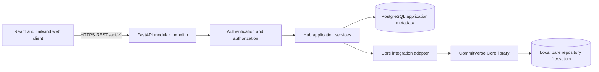

# CommitVerse Hub Architecture

## Status and scope

This document records the reviewed architecture for CommitVerse Hub. The
`apps/hub-api/` implementation includes registration/login/logout and
current-user APIs, authenticated owner-only personal repository metadata CRUD,
organization metadata and membership APIs, and shared
personal/organization bare-repository lifecycle integration with Core.
Organization-owned repository HTTP routes, direct repository grant management,
and repository-scoped invitation APIs are implemented. Bounded authorized
repository browsing is implemented; repository invitation web workflows,
external email delivery, advanced browsing, and broader collaboration remain
unimplemented. The frontend authentication foundation, personal repository
workflows, and supported organization/membership workflows are implemented. Hub is a local-development-first application that builds on, but
does not absorb or replace, CommitVerse Core. CommitVerse AI remains future
scope.

The initial architecture is a **modular monolith**: one Python/FastAPI
application, one PostgreSQL metadata database, a separately stored repository
filesystem, and a React/Tailwind web client. REST endpoints are versioned under
`/api/v1`. The API package and optional SQLAlchemy/Psycopg/Alembic foundation
and initial metadata models/migration exist. Local PostgreSQL 17.11 migration
validation against native Homebrew PostgreSQL on macOS/Apple Silicon M2
historically covered only initial revision `40037b3edad7`. The current source
migration head is `a7d4d1d1f7ed`; that revision has not been verified against
PostgreSQL. Organization-owned repository HTTP routes and direct repository
  grant-management and organization- and repository-invitation routes are
  implemented locally. Supported content authorization is implemented;
  hosted runtime services and deployment configuration remain unimplemented
  or unverified.

## Goals and boundaries

- Hub owns accounts, browser authentication, authorization, profiles,
  organizations, repository metadata, invitations, and collaboration workflows.
- Core owns Git objects, trees, commits, refs, and supported repository
  operations. It remains independently usable and must not depend on Hub,
  FastAPI, or SQLAlchemy.
- PostgreSQL stores Hub application metadata only. Git objects remain in bare
  repositories on the filesystem.
- Hub authorizes a request before any repository is opened through Core.
- AI services, network Git protocols, and cloud deployment are not part of the
  initial implementation.

## System architecture



The browser is an untrusted client. Routes validate transport input and
delegate business operations to services. Services perform permission checks
and coordinate database and repository work. The Core adapter calls the
installed Core package in-process; it is not an HTTP API and does not make
Core aware of Hub identities or permissions.

## Modular monolith and dependency direction

One application process boundary keeps initial development and operation
straightforward: no service discovery, distributed transactions, or
service-to-service authentication is needed. Modules still have explicit
interfaces so extraction remains possible if independently measured scaling
or operational needs arise. Do not start with microservices.

```text
FastAPI routers -> application services -> domain rules and authorization
                                      -> persistence adapters -> PostgreSQL
                                      -> Core adapter -> CommitVerse Core
```

The domain and service layers must not import FastAPI route objects. Core must
not import any Hub module. The Core adapter and persistence layer are the only
Hub boundaries to those respective systems. Avoid generic abstractions without
a concrete use case; keep data-access operations focused.

## Backend module responsibilities

The table distinguishes existing foundations from planned workflows:

| Module | Responsibility |
|---|---|
| `api/v1` | Versioned REST routers, HTTP input/output, dependency wiring, and HTTP error mapping. Keep handlers thin. |
| `schemas` | Pydantic request/response models and validation; no database or filesystem access. |
| `auth` | **Implemented:** Argon2id registration/login, opaque server-side sessions, current-principal resolution, logout/revocation, validated cookies, and exact-Origin/session-bound CSRF checks for state-changing requests. |
| `users` | Account state and profile workflows. |
| `organizations` | **Implemented API:** organization metadata, membership, and organization-scoped invitation create/list/revoke/accept workflows; teams remain deferred. |
| `repositories` | **Implemented:** personal and owner/admin organization-scoped metadata APIs, repository invitation create/list/revoke/accept APIs, and Core-backed repository lifecycle operations. |
| `permissions` | Central deny-by-default policy evaluation for public/private access, ownership, memberships, and direct grants. |
| `repository_ops` | **Implemented for repository lifecycle:** current personal-owner or organization owner/admin authorization, database row locks, safe provisioning/deletion, and explicit retryable failure states. General repository operations remain planned. |
| `core_adapter` | **Implemented:** calls Core bare initialization/discovery APIs in-process and maps failures to safe Hub outcomes. |
| `persistence` | SQLAlchemy models and focused database queries/commands. |
| `db` | PostgreSQL engine/session lifecycle and Alembic migration integration. |
| `config` | Validated settings from local/deployment environment; never embeds secrets. |
| `errors` and `logging` | Stable application errors, request correlation, structured logs, and safe diagnostics. |

### Organization and membership rules

Organization creation atomically creates the creator's owner membership.
Owners and admins may update organization metadata; owners alone may change
non-owner roles and transfer ownership. Owners may add admins or members;
admins may add members only. Owners may remove admins or members, while admins
may remove members only. A member may leave. Ownership transfer requires the
current owner's password and changes the previous owner to admin.

Mutations revalidate the active actor, organization state, and membership role
inside a transaction. Mutations on an existing organization lock its row
before membership and user rows; multi-user operations acquire user rows in
ascending UUID order.
Owner-affecting organization operations must leave at least one active owner;
the invariant is enforced by the service transaction, not a row-level database
constraint. Hub has no account-deactivation workflow. Independent account-state
changes that bypass the organization locking protocol are not covered by this
invariant; any future deactivation workflow must coordinate with organization
ownership. Audit events are committed atomically with the corresponding
organization or membership change.

The organization schema permits `active` and `disabled` states. Disabled
organizations remain readable to existing members, while mutations are
rejected. There is no organization disable/enable operation, terminal
organization deletion, or organization `deleted` state in the implemented
scope.

## API strategy

Use REST under `/api/v1`, with resource-oriented endpoints for authentication,
profiles, organizations, repositories, and memberships as each is implemented.
Return stable error codes and request IDs; do not expose stack traces, local
paths, SQL, object-store details, or raw Core exceptions. GraphQL is not
required by the initial use cases and would add schema/runtime complexity
without a demonstrated need.

The API currently provides account registration/login/logout, current-user
resolution, owner-only personal repository metadata/lifecycle routes, and
organization metadata/membership operations with role-based authorization.
The shared lifecycle service and HTTP API support organization-owned repository
creation and deletion for current organization owners/admins.
The organization HTTP API does not include disable/enable or delete routes.
Direct membership creation takes an existing user ID; organization invitation
routes support email-bound acceptance, repository invitation routes support
manager-controlled issue/list/revoke and authenticated email-bound acceptance,
and the user directory supports bounded public-profile prefix search. No
repository-invitation web workflows or email delivery are implemented.
Repository visibility enables anonymous read-only
browsing only for ready public repositories; detail and mutations remain
authenticated. Do not advertise normal Git
client clone, fetch, or push.

## CommitVerse Core integration

Hub calls Core library APIs behind `core_adapter`; it does not shell out to
system Git, use GitPython, or substitute another Git engine. Core remains
installable and useful without Hub.

Current Core supports repository initialization/discovery, including bare
repositories, and local filesystem transport with library-level fetch, push,
and clone operations. These operations are not `cv` CLI commands. Core does not
implement Git-over-HTTP, Git-over-SSH, network Git transport, packfile
transfer, or normal remote Git client interoperability. Hub MVP therefore
cannot accept ordinary network-based Git clone/fetch/push.

For repository provisioning, Hub assigns an opaque storage key, derives a path
beneath `HUB_REPOSITORY_STORAGE_ROOT`, and asks Core to initialize and verify a
bare repository there. Personal and organization-owned repositories use the
same storage layout and lifecycle service. Current APIs do not expose
organization repository operations or repository contents. Map expected Core
errors to stable Hub errors; never expose storage paths or internal details in
API responses.

Core's compare-and-swap reference updates protect a single ref update under
their supported protocol. They are not a transaction over multiple refs,
objects, metadata, or concurrent multi-user operations. Repository lifecycle
metadata uses database row locks: organization-owned operations lock the
organization before its repository, while personal operations lock the
repository. Transactions commit before any Core or filesystem work. These
locks coordinate metadata transitions across workers using PostgreSQL, but
do not establish shared-filesystem or multi-host guarantees; cross-process
failure and storage behavior still require deployment-specific verification.

Network Git client support is a distinct future engineering milestone. It
requires an explicitly designed and security-tested receive/upload protocol,
including packfile behavior and resource limits, implemented without
delegating production VCS work to another Git engine.

## Repository storage and lifecycle

Store repository data outside the application source tree and outside
PostgreSQL. The generated opaque storage key maps to a bare repository directly
beneath `HUB_REPOSITORY_STORAGE_ROOT`, for example
`<storage-root>/<opaque-id>.git/`. Never construct the storage key or path from
a username, repository slug, or untrusted request value.

The shared repository metadata record has lifecycle states `provisioning`,
`ready`, `error`, `deleting`, and `deleted`. Personal repositories have a
`owner_user_id`; organization repositories have an `owner_organization_id`;
exactly one owner is set. Both use the same opaque storage key format, storage
root, and lifecycle service. Organization-owned lifecycle operations are exposed
through owner/admin-scoped organization repository API routes. Ordinary members
do not receive implicit repository visibility.

Creation is recoverable, not an atomic database/filesystem transaction:

1. **Reservation transaction:** for organization repositories, lock the
   organization, validate its active state and the actor's current active
   owner/admin membership, then reserve `provisioning`. Personal repositories
   validate the authenticated owner. Write the reservation audit event in the
   same transaction.
2. **Provisioning:** outside any database transaction, initialize and verify
   the bare repository through Core in a controlled temporary sibling path.
3. **Publication transaction:** lock the organization first (when applicable)
   and then the repository; revalidate ownership, organization state, and
   current membership/role; mark `ready` and write the creation audit event
   atomically.
4. On failure, safely clean only storage published by that attempt and record
   `error` with its audit event. Existing `error` reservations can be retried;
   an in-progress `provisioning` reservation is not concurrently reused.

Deletion uses the same organization-before-repository lock order. In one
transaction it checks current ownership/role, marks `deleting`, revokes
repository grants and pending invitations, and writes the transition audit
event. It commits before storage cleanup. Core/filesystem cleanup occurs
outside a transaction and tolerates already-removed storage. A final
organization-then-repository transaction sets the ID-derived tombstone slug,
marks `deleted`, and writes the final audit event atomically. Cleanup and
finalization failures remain retryable. Automated reconciliation of abandoned
states is not implemented; no service may guess paths or remove an unverified
location.

Use least-privilege filesystem permissions and reject symlinked path components
or resolved paths that escape the storage root. Local filesystem storage is a
development architecture, not a claim of multi-host replication, backup, or
production recovery. Define and test backup/restore and reconciliation before
handling valuable hosted data.

## Frontend architecture

The proposed client uses React and Tailwind CSS, organized around route-level
features:

```text
src/
├── app/                 # App shell, routing, session bootstrap
├── features/
│   ├── auth/
│   ├── dashboard/
│   ├── profile/
│   ├── repositories/
│   └── organizations/
├── components/          # Accessible shared UI primitives
├── lib/                 # REST client, validation, formatting
└── styles/
```

Start with route-local state and a small API client; add a server-state cache
only when actual screens need it. Provide keyboard access, semantic controls,
responsive layouts, form validation, and explicit loading, empty, error, and
retry states. Follow the established warm-white/charcoal visual direction with
muted peach and sage accents, restrained depth, and no excessive gradients or
glow.

## Deployment boundaries and zero-cost constraint

Initial Hub development remains local. The strict ₹0 policy in
[`../infrastructure/zero-cost-policy.md`](../infrastructure/zero-cost-policy.md)
is mandatory. Cloudflare Pages Free is planned for static frontend hosting,
Cloudflare Workers Free only for suitable lightweight endpoints, Neon
PostgreSQL Free for metadata, and local filesystem for Core repositories during
development. Workers must not run the Python Git engine.

There is currently **no verified, approved zero-cost hosting solution** for the
complete Python FastAPI application together with filesystem-backed repository
storage. Hub is not cloud-deployment-ready. Deployment readiness is blocked
until a compliant Python runtime and repository-storage solution is separately
verified without billing activation, payment methods, paid trials, or
pay-as-you-go. If a free quota is reached, pause, degrade, or migrate without
incurring charges. AWS, Render, Fly.io, Railway, and other excluded providers
must not be recommended; Cloudflare R2 remains deferred unless a genuinely
no-billing arrangement is possible.

Docker is not required for the current local development setup, which uses
native Homebrew PostgreSQL. Docker/Compose remain optional future tools for
reproducible or containerized environments; they do not solve the hosting
blocker and no deployment configuration is implied.

## Decisions and limitations

- **Accepted:** modular monolith, FastAPI/Python, React/Tailwind, PostgreSQL,
  SQLAlchemy/Alembic, REST `/api/v1`, opaque server-side browser sessions,
  filesystem-backed bare repositories during development, dedicated Core
  adapter.
- **Implemented locally:** registration/login/logout, current-user resolution,
  owner-only personal repository APIs, owner/admin organization repository
  metadata APIs, and shared Core-backed personal and organization repository
  lifecycle services with transactional audit events and retryable states.
  Historical PostgreSQL 17.11 migration validation
  covered only initial revision `40037b3edad7`; current source head
  `a7d4d1d1f7ed` is not verified against PostgreSQL. Organization concurrency
  tests require `HUB_TEST_DATABASE_URL`; without it, PostgreSQL row-lock
  concurrency is unverified.
- **Implemented locally:** authenticated bounded tree/blob/history browsing,
  reachable commit details, and first-parent diffs from HEAD, local branches,
  and direct-commit tags.
- **Not implemented:** repository invitation web workflows and email delivery,
  advanced diff workflows,
  automated lifecycle
  reconciliation, broader collaboration workflows, and deployment. No hosted
  deployment has been verified.
- **Not available from Core:** network Git protocols, packfiles, and ordinary
  remote-client interoperability.
- **Operational limitations:** DB/filesystem operations are not atomic;
  PostgreSQL row locks cover lifecycle metadata transactions but not shared
  storage or multi-host deployment; automated lifecycle reconciliation,
  bounded execution, and backup/recovery are not implemented.
- **Future scope:** teams/complex inherited permissions, issues, pull requests,
  broad collaboration features, and CommitVerse AI.

See [`database-design.md`](database-design.md),
[`security-architecture.md`](security-architecture.md), and
[`implementation-roadmap.md`](implementation-roadmap.md) for detailed design.
