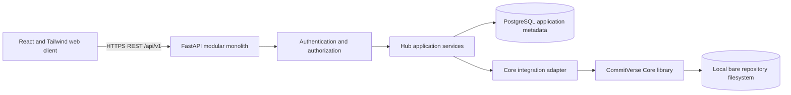

# CommitVerse Hub Architecture

## Status and scope

This document records the reviewed architecture for CommitVerse Hub. The
`apps/hub-api/` implementation includes registration/login/logout and
current-user APIs, authenticated owner-only personal repository metadata CRUD,
and local bare-repository lifecycle integration with Core. Organization and
collaborator authorization, repository browsing, and broader collaboration
features are not implemented. Hub is a local-development-first application
that builds on, but does not absorb or replace, CommitVerse Core.
CommitVerse AI remains future scope.

The initial architecture is a **modular monolith**: one Python/FastAPI
application, one PostgreSQL metadata database, a separately stored repository
filesystem, and a React/Tailwind web client. REST endpoints are versioned under
`/api/v1`. The API package and optional SQLAlchemy/Psycopg/Alembic foundation
and initial metadata models/migration exist. Local PostgreSQL 17.11 migration
validation has been completed against a native Homebrew installation on
macOS/Apple Silicon M2. Organization/collaboration workflows, hosted runtime
services, and deployment configuration remain unimplemented or unverified.

## Goals and boundaries

- Hub owns accounts, browser authentication, authorization, profiles,
  organizations, repository metadata, invitations, and collaboration workflows.
- Core owns Git objects, trees, commits, refs, and supported repository
  operations. It remains independently usable and must not depend on Hub,
  FastAPI, or SQLAlchemy.
- PostgreSQL stores Hub application metadata only. Git objects remain in bare
  repositories on the filesystem.
- Hub authorizes a request before any repository is opened through Core.
- AI services, network Git protocols, and cloud deployment are not part of the
  initial implementation.

## System architecture



The browser is an untrusted client. Routes validate transport input and
delegate business operations to services. Services perform permission checks
and coordinate database and repository work. The Core adapter calls the
installed Core package in-process; it is not an HTTP API and does not make
Core aware of Hub identities or permissions.

## Modular monolith and dependency direction

One application process boundary keeps initial development and operation
straightforward: no service discovery, distributed transactions, or
service-to-service authentication is needed. Modules still have explicit
interfaces so extraction remains possible if independently measured scaling
or operational needs arise. Do not start with microservices.

```text
FastAPI routers -> application services -> domain rules and authorization
                                      -> persistence adapters -> PostgreSQL
                                      -> Core adapter -> CommitVerse Core
```

The domain and service layers must not import FastAPI route objects. Core must
not import any Hub module. The Core adapter and persistence layer are the only
Hub boundaries to those respective systems. Avoid generic abstractions without
a concrete use case; keep data-access operations focused.

## Backend module responsibilities

The table distinguishes existing foundations from planned workflows:

| Module | Responsibility |
|---|---|
| `api/v1` | Versioned REST routers, HTTP input/output, dependency wiring, and HTTP error mapping. Keep handlers thin. |
| `schemas` | Pydantic request/response models and validation; no database or filesystem access. |
| `auth` | **Implemented:** Argon2id registration/login, opaque server-side sessions, current-principal resolution, logout/revocation, validated cookies, and exact-Origin/session-bound CSRF checks for state-changing requests. |
| `users` | Account state and profile workflows. |
| `organizations` | Organization and membership workflows; teams are deferred. |
| `repositories` | **Implemented for personal repositories:** owner-scoped metadata, name/visibility validation, list/detail/update/delete, audit events, and retryable lifecycle state transitions. Organization repositories remain planned. |
| `permissions` | Central deny-by-default policy evaluation for public/private access, ownership, memberships, and direct grants. |
| `repository_ops` | **Implemented for lifecycle operations:** authenticated personal ownership checks, a process-local lifecycle lock, safe provisioning/deletion, and explicit retryable failure states. Cross-process coordination and general repository operations remain planned. |
| `core_adapter` | **Implemented:** calls Core bare initialization/discovery APIs in-process and maps failures to safe Hub outcomes. |
| `persistence` | SQLAlchemy models and focused database queries/commands. |
| `db` | PostgreSQL engine/session lifecycle and Alembic migration integration. |
| `config` | Validated settings from local/deployment environment; never embeds secrets. |
| `errors` and `logging` | Stable application errors, request correlation, structured logs, and safe diagnostics. |

## API strategy

Use REST under `/api/v1`, with resource-oriented endpoints for authentication,
profiles, organizations, repositories, and memberships as each is implemented.
Return stable error codes and request IDs; do not expose stack traces, local
paths, SQL, object-store details, or raw Core exceptions. GraphQL is not
required by the initial use cases and would add schema/runtime complexity
without a demonstrated need.

The API currently provides account registration/login/logout, current-user
resolution, and owner-only personal repository metadata/lifecycle routes.
Repository visibility is stored as metadata but does not enable anonymous
access; detail and mutations remain owner-only. Do not advertise normal Git
client clone, fetch, or push.

## CommitVerse Core integration

Hub calls Core library APIs behind `core_adapter`; it does not shell out to
system Git, use GitPython, or substitute another Git engine. Core remains
installable and useful without Hub.

Current Core supports repository initialization/discovery, including bare
repositories, and local filesystem transport with library-level fetch, push,
and clone operations. These operations are not `cv` CLI commands. Core does not
implement Git-over-HTTP, Git-over-SSH, network Git transport, packfile
transfer, or normal remote Git client interoperability. Hub MVP therefore
cannot accept ordinary network-based Git clone/fetch/push.

For personal repository provisioning, Hub assigns an opaque storage key, derives
a path beneath `HUB_REPOSITORY_STORAGE_ROOT`, and asks Core to initialize and
verify a bare repository there. Current APIs do not expose repository contents.
Map expected Core errors to stable Hub errors; never expose storage paths or
internal details in API responses.

Core's compare-and-swap reference updates protect a single ref update under
their supported protocol. They are not a transaction over multiple refs,
objects, metadata, or concurrent multi-user operations. Hub must coordinate
operations per repository, bound work outside the ASGI event loop, and test
concurrent requests and failures explicitly. An in-process lock is only
process-local; any multi-process deployment requires a separately designed
and tested cross-process coordination mechanism.

Network Git client support is a distinct future engineering milestone. It
requires an explicitly designed and security-tested receive/upload protocol,
including packfile behavior and resource limits, implemented without
delegating production VCS work to another Git engine.

## Repository storage and lifecycle

Store repository data outside the application source tree and outside
PostgreSQL. The generated opaque storage key maps to a bare repository directly
beneath `HUB_REPOSITORY_STORAGE_ROOT`, for example
`<storage-root>/<opaque-id>.git/`. Never construct the storage key or path from
a username, repository slug, or untrusted request value.

The Hub metadata record has lifecycle states `provisioning`, `ready`,
`deleting`, and `error`. Creation is a recoverable workflow, not an atomic
database/filesystem transaction:

1. Validate the authenticated personal owner, repository name, and visibility.
2. Create metadata in `provisioning` and generate a unique opaque storage key.
3. Initialize a bare repository in a controlled temporary sibling location
   using Core; validate the result.
4. Publish it beneath the configured storage root and mark metadata `ready`.
5. On provisioning failure, record `error` and clean only the known temporary
   path. Automated reconciliation of abandoned states is not implemented.

Deletion first marks the record `deleting`, prevents current ready-only API
operations, removes the known repository path through a narrowly scoped
lifecycle service, and then tombstones the metadata record. Failures remain
visible and retryable. Automated reconciliation is not yet implemented; no
service may guess paths or remove an unverified location.

Use least-privilege filesystem permissions and reject symlinked path components
or resolved paths that escape the storage root. Local filesystem storage is a
development architecture, not a claim of multi-host replication, backup, or
production recovery. Define and test backup/restore and reconciliation before
handling valuable hosted data.

## Frontend architecture

The proposed client uses React and Tailwind CSS, organized around route-level
features:

```text
src/
├── app/                 # App shell, routing, session bootstrap
├── features/
│   ├── auth/
│   ├── dashboard/
│   ├── profile/
│   ├── repositories/
│   └── organizations/
├── components/          # Accessible shared UI primitives
├── lib/                 # REST client, validation, formatting
└── styles/
```

Start with route-local state and a small API client; add a server-state cache
only when actual screens need it. Provide keyboard access, semantic controls,
responsive layouts, form validation, and explicit loading, empty, error, and
retry states. Follow the established warm-white/charcoal visual direction with
muted peach and sage accents, restrained depth, and no excessive gradients or
glow.

## Deployment boundaries and zero-cost constraint

Initial Hub development remains local. The strict ₹0 policy in
[`../infrastructure/zero-cost-policy.md`](../infrastructure/zero-cost-policy.md)
is mandatory. Cloudflare Pages Free is planned for static frontend hosting,
Cloudflare Workers Free only for suitable lightweight endpoints, Neon
PostgreSQL Free for metadata, and local filesystem for Core repositories during
development. Workers must not run the Python Git engine.

There is currently **no verified, approved zero-cost hosting solution** for the
complete Python FastAPI application together with filesystem-backed repository
storage. Hub is not cloud-deployment-ready. Deployment readiness is blocked
until a compliant Python runtime and repository-storage solution is separately
verified without billing activation, payment methods, paid trials, or
pay-as-you-go. If a free quota is reached, pause, degrade, or migrate without
incurring charges. AWS, Render, Fly.io, Railway, and other excluded providers
must not be recommended; Cloudflare R2 remains deferred unless a genuinely
no-billing arrangement is possible.

Docker is not required for the current local development setup, which uses
native Homebrew PostgreSQL. Docker/Compose remain optional future tools for
reproducible or containerized environments; they do not solve the hosting
blocker and no deployment configuration is implied.

## Decisions and limitations

- **Accepted:** modular monolith, FastAPI/Python, React/Tailwind, PostgreSQL,
  SQLAlchemy/Alembic, REST `/api/v1`, opaque server-side browser sessions,
  filesystem-backed bare repositories during development, dedicated Core
  adapter.
- **Implemented locally:** registration/login/logout, current-user resolution,
  owner-only personal repository CRUD, Core-backed bare repository creation
  and deletion, audit events, and retryable lifecycle states. Local
  PostgreSQL 17.11 migration validation is complete.
- **Not implemented:** organization/collaborator authorization, anonymous
  public access, repository browsing, automated lifecycle reconciliation,
  frontend, and deployment. No hosted deployment has been verified.
- **Not available from Core:** network Git protocols, packfiles, and ordinary
  remote-client interoperability.
- **Operational limitations:** DB/filesystem operations are not atomic;
  lifecycle locking is process-local; automated reconciliation, bounded
  cross-process execution, and backup/recovery are not implemented.
- **Future scope:** teams/complex inherited permissions, issues, pull requests,
  broad collaboration features, and CommitVerse AI.

See [`database-design.md`](database-design.md),
[`security-architecture.md`](security-architecture.md), and
[`implementation-roadmap.md`](implementation-roadmap.md) for detailed design.
