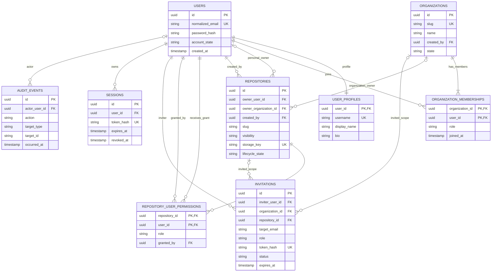

# CommitVerse Hub Database Design

## Status and database boundary

This approved initial Hub PostgreSQL schema is implemented in SQLAlchemy
models and Alembic revision `40037b3edad7`
([initial migration](../../apps/hub-api/migrations/versions/40037b3edad7_create_initial_hub_schema.py)).
It defines metadata only; PostgreSQL owns no CommitVerse Core repository
objects, refs, or bare repository files. Live PostgreSQL migration validation
is complete against the local PostgreSQL 17.11 development server. Application
workflows have not been implemented.

The migration creates `users`, `user_profiles`, `organizations`,
`organization_memberships`, `repositories`,
`repository_user_permissions`, `invitations`, `sessions`, and `audit_events`.
The models share `Base.metadata`; invitations are represented for schema
consistency, but invitation workflows remain post-MVP. The migration was
successfully upgraded, downgraded to `base`, and upgraded again against
PostgreSQL 17.11; `alembic current` confirmed `40037b3edad7 (head)`. The schema
was also exercised on a temporary SQLite database for isolated tests; that
test coverage is distinct from, and does not replace, the completed live
PostgreSQL verification.

## Verified local PostgreSQL setup

The verified development environment is macOS on Apple Silicon M2, with
PostgreSQL 17.11 installed natively through Homebrew and managed by
`brew services`. The database is `commitverse`, owned by `commitverse_app`,
at `localhost:5432`, accessed through Psycopg 3 and SQLAlchemy 2.x. Docker is
not required for this local setup; it remains an optional future infrastructure
tool. This verification does not imply cloud deployment readiness.

Configure `HUB_DATABASE_URL` in the local shell using a locally managed,
URL-encoded password; never store the real URL in documentation, source
control, or an `.env` file. A placeholder example is:

```sh
export HUB_DATABASE_URL='postgresql+psycopg://commitverse_app:<URL-encoded-password>@localhost:5432/commitverse'
```

Run migration commands from `apps/hub-api/`:

```sh
../../.venv/bin/alembic -c alembic.ini upgrade head
../../.venv/bin/alembic -c alembic.ini downgrade base
../../.venv/bin/alembic -c alembic.ini upgrade head
../../.venv/bin/alembic -c alembic.ini current
```

The verified current revision is `40037b3edad7 (head)`. Never commit
credentials or change PostgreSQL authentication settings as part of this
documentation.

Use SQLAlchemy for persistence and Alembic for versioned schema migrations.
Use UUID primary keys for externally addressable entities. Use database
constraints for durable invariants and service-level transactions for
multi-row workflows. A database transaction cannot make filesystem operations
atomic.

## Initial metadata model

The user, profile, organization, membership, repository, direct-permission,
session, and audit records support the MVP foundation. Invitation records and
their lifecycle are designed below, but invitation workflows are post-MVP.

### Users and profiles

- `users`: UUID `id` primary key; normalized email; password hash; account
  state; created/updated timestamps. Email is unique case-insensitively.
- `user_profiles`: `user_id` is both primary key and FK to `users.id`;
  case-insensitive unique username, display name, optional bio and avatar URL.
- Registration creates the corresponding profile in the same PostgreSQL
  transaction, keeping the proposed one-to-one relationship complete.
- Keep account state separate from profile. Disable/deactivate accounts rather
  than deleting identity rows referenced by audit or ownership records.

### Organizations and memberships

- `organizations`: UUID primary key, unique case-insensitive slug, name,
  `created_by` FK to users, state and timestamps.
- `organization_memberships`: composite primary key
  `(organization_id, user_id)`, FKs to organizations and users, role, joined
  timestamp. Initial roles are `owner`, `admin`, and `member`.
- Creating an organization also inserts its creator as an `owner` membership in
  the same PostgreSQL transaction.
- An organization must retain at least one active owner. Enforce this through
  a transactional service rule; it cannot be expressed as a simple row-level
  CHECK constraint.

Teams and team membership are intentionally outside the MVP schema. Avoid
implicit organization-wide repository access based only on membership.

### Repositories and ownership

- `repositories`: UUID primary key; nullable `owner_user_id` and
  `owner_organization_id` FKs; slug; visibility (`public` or `private`);
  generated unique `storage_key`; lifecycle state; description and timestamps.
- A CHECK constraint requires exactly one owner:
  `(owner_user_id IS NOT NULL) <> (owner_organization_id IS NOT NULL)`.
- Personal repository slug uniqueness is case-insensitive within the personal
  owner namespace. Organization repository slug uniqueness is
  case-insensitive within that organization. Use partial unique indexes for
  the two owner cases.
- `storage_key` is generated independently of the owner and slug, unique, and
  never accepted from an API request. It maps to a path below one configured
  repository root.
- `created_by` is a required user FK, separate from ownership, for
  auditability even when the owner is an organization.

The schema stores repository metadata, not content. Lifecycle states are
`provisioning`, `ready`, `deleting`, and `error`; see the lifecycle protocol in
[`architecture.md`](architecture.md#repository-storage-and-lifecycle).

### Direct collaborator permissions

- `repository_user_permissions`: composite primary key
  `(repository_id, user_id)`, FKs to repositories and users, role, grantor,
  created/updated timestamps.
- `granted_by` is a required FK to the granting user; use restrictive deletion
  behavior or account deactivation so grant history is not orphaned.
- Initial roles: `reader`, `writer`, `admin`. Keep one effective direct grant
  per repository/user; update the row rather than accumulating overlapping
  grants.
- A repository owner is not represented as a collaborator grant. Service logic
  must not allow a direct grant to weaken or override ownership.

### Invitations (post-MVP workflow)

- `invitations`: UUID primary key; inviter FK; normalized target email;
  nullable `organization_id` and `repository_id` FKs; role appropriate to the
  selected scope; unique hash of a random invitation token; status; expiry,
  creation, acceptance, and revocation timestamps.
- A CHECK constraint requires exactly one of `organization_id` or
  `repository_id` to be non-null. Organization-scoped invitations create
  organization membership after acceptance; repository-scoped invitations
  create a direct collaborator permission. Do not use an ambiguous generic
  target string.
- Valid status transitions: `pending -> accepted`, `pending -> revoked`, or
  `pending -> expired`; terminal states cannot be reopened. Acceptance requires
  a matching authenticated account email, a valid unexpired token, and a
  transaction that creates the membership/grant exactly once.
- Store only the token hash. Revoke/expire pending invitations when their scope
  is deleted or becomes invalid. A partial unique index should prevent
  duplicate pending invitations for the same normalized email and scope.
- The table and constraints are designed here for consistency, but invitation
  issuance/acceptance is not required for the initial MVP; implement it with
  the post-MVP organization collaboration workflows.

### Sessions

- `sessions`: UUID primary key, user FK, unique hash of a high-entropy opaque
  token, created/last-used/expiry/revocation timestamps, and minimal optional
  client metadata.
- Store only token hashes; never persist or log raw cookie values.
- Index token hash for lookup and `(user_id, expires_at)` for session
  management/cleanup. Revoked or expired rows are invalid immediately and may
  be cleaned after a retention period.

### Audit events

- `audit_events`: UUID primary key; nullable actor user FK for system actions;
  action, target type, target identifier, timestamp, request/correlation ID,
  and allow-listed structured metadata.
- Index `(occurred_at)`, `(actor_user_id, occurred_at)`, and
  `(target_type, target_id, occurred_at)`.
- Treat events as append-only through application policy. Do not include
  passwords, session/invitation tokens, repository contents, or unrestricted
  request bodies. Define retention and access limits before deployment.

## Ownership and effective authorization

Evaluate access in the Hub authorization service on every request:

1. A `ready` public repository permits anonymous read-only metadata and
   supported browsing; private repositories require an authenticated grant.
2. A personal repository owner has full repository administration rights.
3. For an organization-owned repository, active organization `owner` and
   `admin` members have repository administration access. An ordinary
   organization `member` does **not** automatically receive repository content
   access.
4. Direct collaborator grants provide the repository role to that user for
   personal or organization-owned repositories. A grant cannot exceed what the
   caller is authorized to grant, and organization owners/admins retain their
   ownership authority.
5. Deny by default when metadata or lifecycle state is missing, inconsistent,
   or not `ready`. Check authorization before opening the Core repository.

A personal owner, organization owner/admin, or repository `admin` collaborator
may manage direct grants, subject to the rule that no grantor can grant a role
above their own authority. Owners cannot be demoted by a collaborator grant.

Initial organization role mapping: `owner`/`admin` manage organization and its
repositories; `member` has no implicit repository permission. Direct
repository roles map to read, write, and repository administration actions.
Detailed write actions remain unavailable until Hub has a supported network
Git operation; do not interpret a database `writer` grant as an implemented
Git push endpoint.

## Relationships and referential integrity



The two optional invitation-scope relationships are governed by the
exactly-one-scope CHECK constraint described above. Likewise, the two optional
repository owner relationships are mutually exclusive. Mermaid ER syntax
expresses those optional FKs but does not encode the SQL CHECK constraints.

Use `RESTRICT` where deletion could orphan ownership or live repository data.
Prefer explicit lifecycle/tombstone operations for accounts and repositories.
Database cascades must never trigger implicit filesystem deletion. Add indexes
for organization membership lookup, repositories by either owner, collaborator
lookup, pending invitation scope/email/expiry, session token hash and user
expiry, and audit actor/target/time queries.

Use CHECK constraints for bounded values such as account/organization state,
membership role, repository visibility/lifecycle state, collaborator role,
invitation status, and scope-compatible invitation role. Use partial unique
indexes for case-insensitive owner-scoped repository slugs and pending
invitation scope/email uniqueness. Scope deletion must revoke and explicitly
remove or retain invitation records according to the retention policy before
removing the referenced row; do not rely on an implicit cascade.

## Future data, not MVP

Issues, pull requests, comments, reviews, notifications, teams, team
memberships, OAuth identities, deploy keys, webhooks, and fine-grained branch
protections are future entities. Add them only with explicit workflows,
authorization rules, retention requirements, and migrations.
